# RadioVelbert Music Scraper

**Radio-Analyse-Tool für Sender, die wissen wollen, was gerade läuft.**

> Entstanden durch Vibecoding — entwickelt mit Claude als KI-Partner. Die Ideen und Anforderungen kamen von einem Radiosender, den Code hat Claude geschrieben.

---

## Was ist Music Scraper?

Music Scraper sammelt Playlisten von Radiosendern automatisch ein, normalisiert sie und wertet sie aus. Es richtet sich an **Radiosender**, **Musikredakteure** und alle, die verstehen wollen, was im Radio gerade gespielt wird.

| Anwendungsfall | Beschreibung |
|---|---|
| **Airplay-Analyse** | Wie oft läuft ein Song bei welchem Sender? Wann war der Peak? |
| **Trend-Erkennung** | Welche Songs gewinnen gerade an Rotation? Was verliert? |
| **Exklusiv-Tracks** | Welche Songs spielt nur dein Sender — und sonst niemand? |
| **Verpasste Songs** | Was läuft bei anderen Sendern oft, aber bei dir noch gar nicht? |
| **Mein Sender** | Vergleich deines eigenen Senders mit dem gesamten Markt |
| **Neue Titel** | Welche Songs sind diese Woche neu ins Radio gekommen? |
| **Wochenberichte** | Automatisch generierte Berichte mit Top-Tracks und Bewegungen |
| **Song-Seite** | Cover, Album, Label, ISRC, Erscheinungsdatum, Mitwirkende und Links (Deezer, Spotify, Apple Music, YouTube …) |
| **Administration** | Sender im Browser verwalten, Abrufe und Jobs überwachen, Datenbankgröße und Wachstum, Daten löschen |

---

## Screenshots

### Dashboard — Track-Katalog

Durchsuchbare, sortierbare Liste aller Tracks in normaler Schreibweise, mit Cover, Plays, Plays/Tag und letztem Einsatz. Ein Klick auf die Zeile öffnet die Song-Seite, der Play-Button spielt ein 30-Sekunden-Hörbeispiel im Player am unteren Fensterrand. Winner/Loser-Buttons für schnelles Track-Merging direkt in der Tabelle.

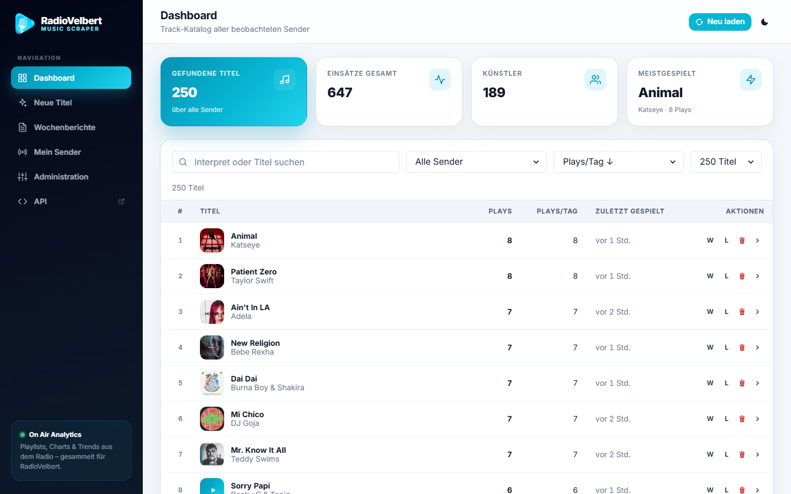

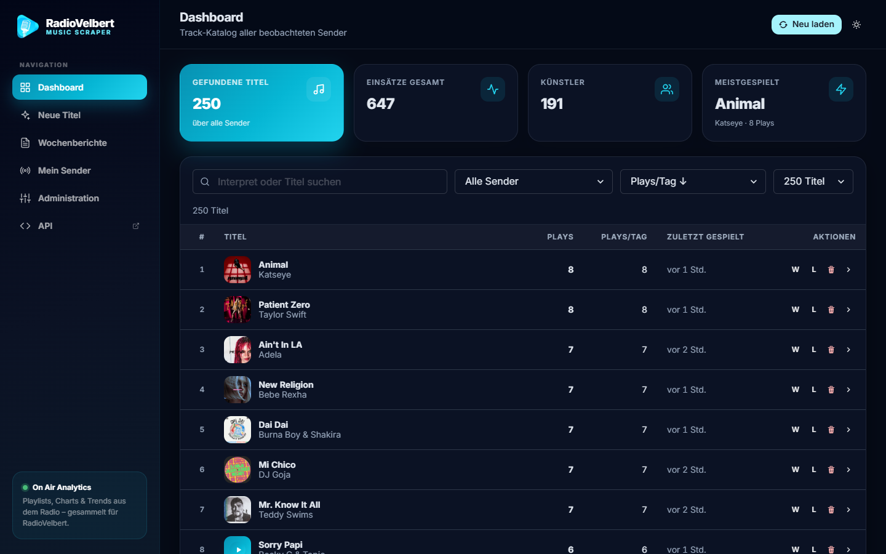

---

### Song-Detail — Performance & Analyse

Jeder Track hat eine eigene Seite: Cover, Album, Label, Genre, Dauer, ISRC (kopierbar), Erscheinungsdatum und Mitwirkende von Deezer, Links zu Deezer, Spotify, Apple Music, YouTube, Genius und MusicBrainz. Darunter: bei welchen Sendern der Titel läuft, die letzten Einsätze, Infos zum Künstler, die Schreibweisen der Sender sowie Score (0–100), Momentum und Sender-Breite.

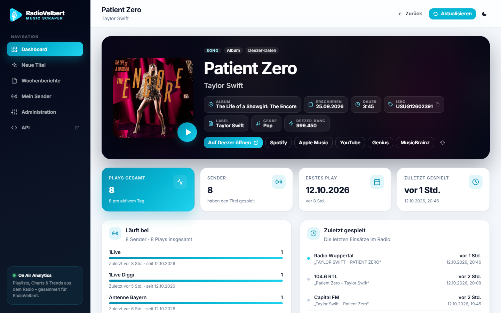

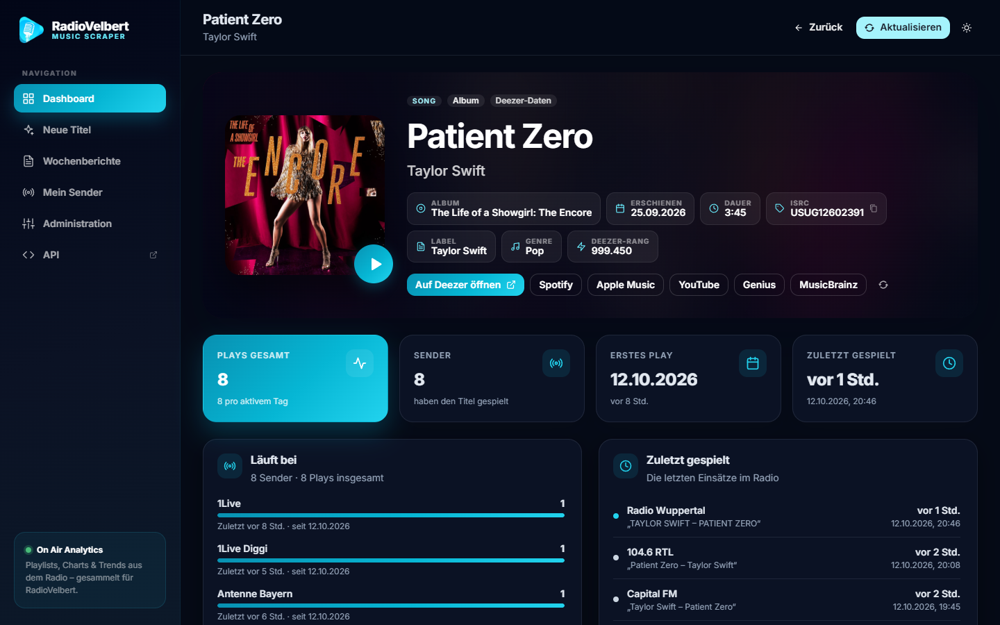

Weiter unten: Kumulierter Verlauf, Plays pro Zeitraum und Sender-Vergleich als Balkendiagramme.

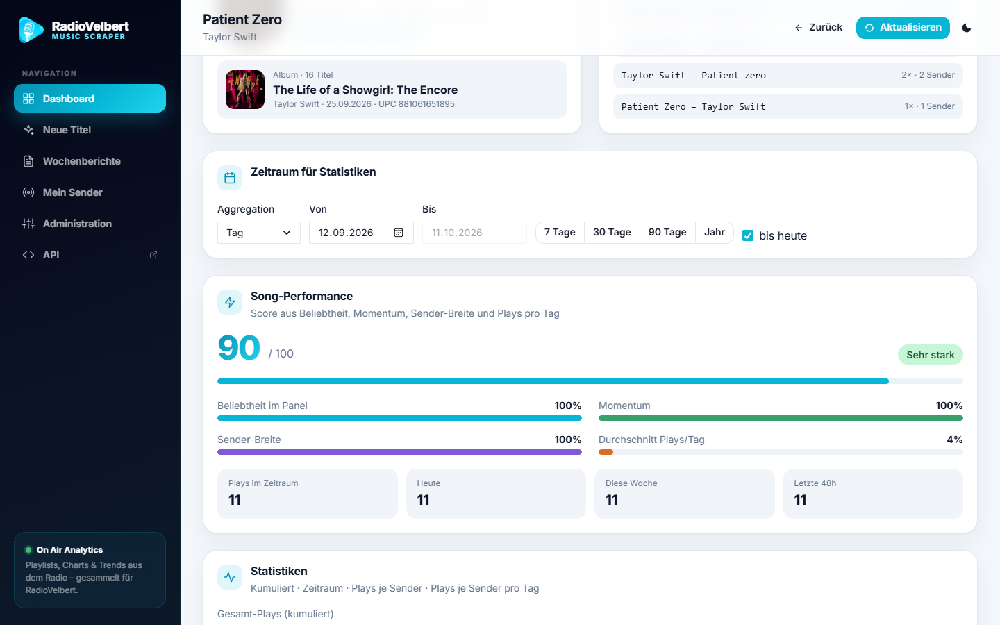

---

### Neue Titel

Alle Songs, die in einem bestimmten Zeitraum zum ersten Mal gespielt wurden — filterbar nach Sender, Release-Datum, Einsatzhäufigkeit und Qualitäts-Score.

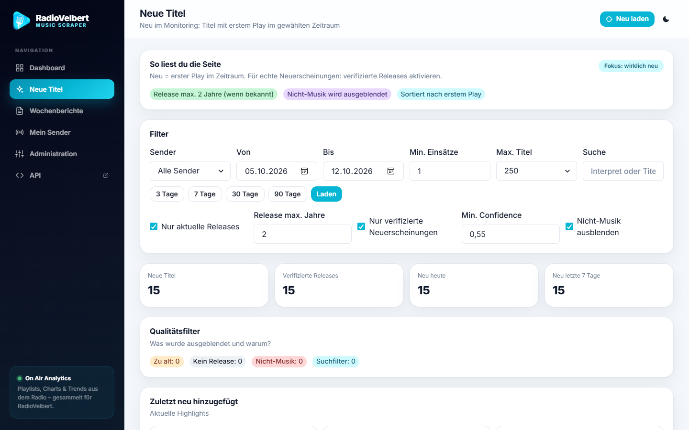

---

### Mein Sender

Wähle deinen Sender aus und vergleiche ihn mit dem Rest des Markts. Zeigt verpasste Tracks, Geheimtipps und Sender-spezifische Rotation.

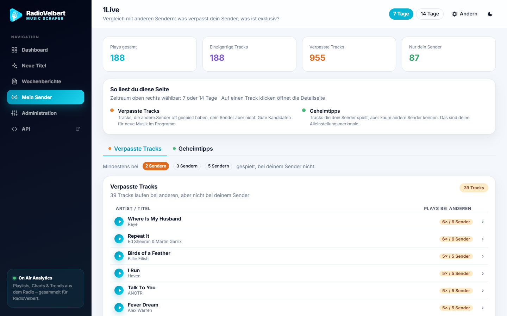

---

### Wochenberichte

Automatisch generierte Übersichten mit Top-Tracks, Neueinsteigern, Absteigern und Sender-Vergleich — für jede abgelaufene Woche abrufbar.

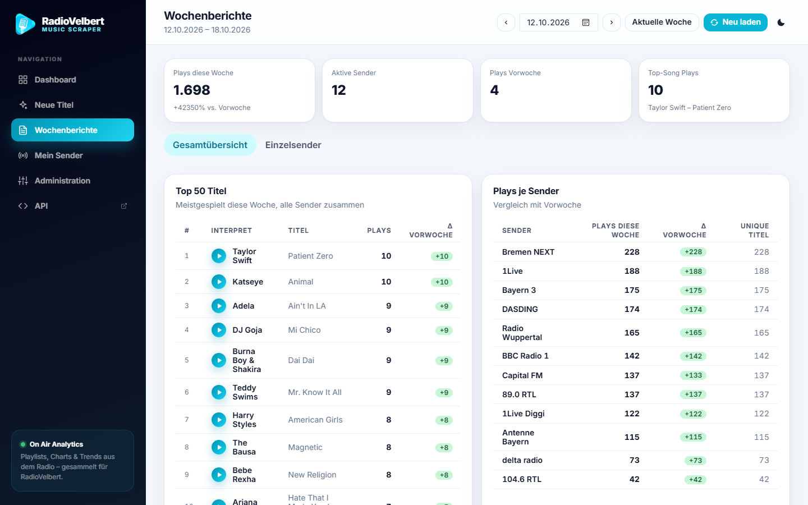

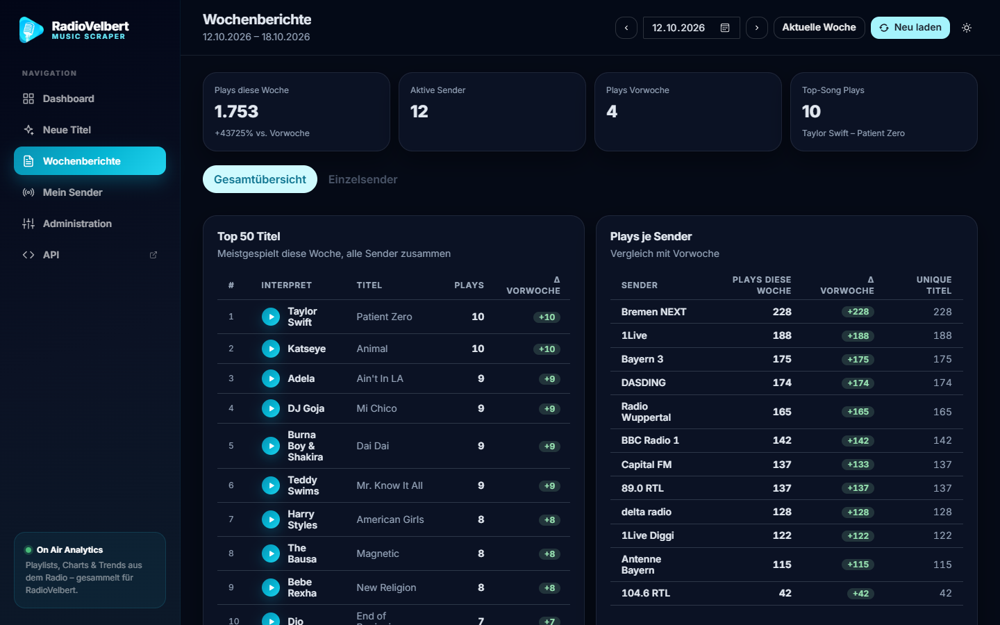

---

### Administration

Sender im Browser anlegen und bearbeiten (onlineradiobox-Suche, laut.fm, beliebige JSON-APIs, HTML-Parser), Quelle vorab testen, Abruf-Intervalle überschreiben. Die Übersicht zeigt, wann welcher Sender zuletzt ausgelesen wurde, was dabei herauskam, welche Jobs laufen, wie groß die Datenbank ist und wie schnell sie wächst.

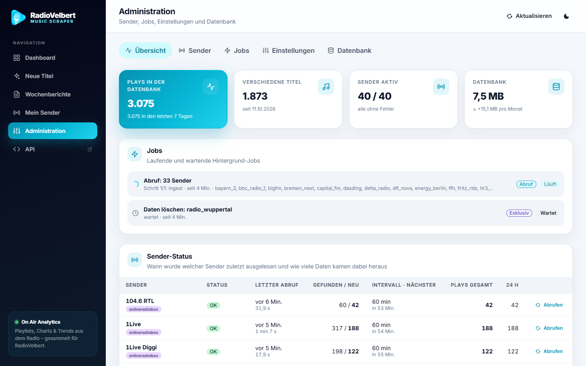

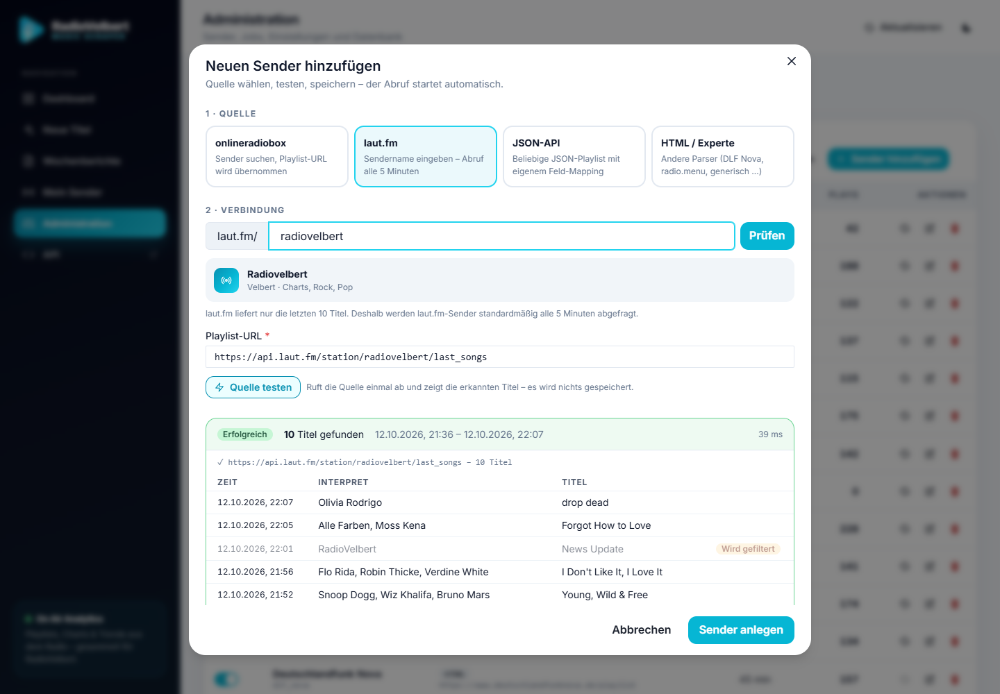

---

## Schnellstart

### Voraussetzungen

- Node.js 20+
- npm

```bash
node -v   # sollte 20+ zeigen
npm -v
```

### Installation

```bash
git clone https://github.com/dergabriel/music-scraper.git
cd music-scraper
npm install
```

### Konfiguration

Sender werden im Browser unter **Administration → Sender** verwaltet. `config.yaml` enthält die Startliste, die beim ersten Start in eine leere Datenbank übernommen wird – siehe [Sender hinzufügen](docs/add-station.md).

Optionale Umgebungsvariablen (`.env` oder Shell-Export):

| Variable | Beschreibung | Standard |
|---|---|---|
| `SPOTIFY_CLIENT_ID` | Spotify API Client-ID | — |
| `SPOTIFY_CLIENT_SECRET` | Spotify API Client-Secret | — |
| `YRPA_VERIFY_ALL_TRACKS` | Alle Tracks gegen iTunes/Spotify prüfen (statt nur verdächtige) | `0` |
| `YRPA_TRACK_VERIFY` | Track-Verifikation aktivieren (`0` = aus) | `1` |
| `YRPA_DEDUP_COOLDOWN_SECONDS` | Cooldown-Fenster für Dedup in Sekunden | `900` |
| `YRPA_TRACK_HOUR_START` / `YRPA_TRACK_HOUR_END` | Startwert für das Erfassungsfenster (danach in der Administration einstellbar) | `6` / `20` |
| `LOG_LEVEL` | Pino Log-Level (`info`, `debug`, …) | `info` |
| `BASIC_AUTH_USER` / `BASIC_AUTH_PASSWORD` | Login für Dashboard und API (beide gesetzt = aktiv; `/api/health` bleibt offen) | — |
| `DB_PATH` | Standard für `--db` | `music-scraper.sqlite` (`api`: `yrpa.sqlite`) |
| `CONFIG_PATH` | Standard für `--config` | — |
| `REPORTS_DIR` | Ausgabeordner für Reports | `reports` |
| `PORT` | Standard für `--port` | `8787` |

### Starten

```bash
node src/cli.js api --config config.yaml --db music-scraper.sqlite --port 8787
```

Der Server startet auf Port `8787`. Direkt danach werden im Hintergrund die Playlisten der konfigurierten Sender eingesammelt.

### Seiten

| Seite | Pfad |
|---|---|
| Dashboard | `/dashboard` |
| Neue Titel | `/new-titles` |
| Mein Sender | `/my-station` |
| Wochenberichte | `/weekly-reports` |
| Administration | `/admin` |
| API Docs | `/api/docs` |

> Der interne Scheduler läuft automatisch: Jede Minute werden fällige Sender abgerufen (Standard stündlich, laut.fm alle 5 Minuten, pro Sender überschreibbar), stündlich Wartung + Tagesauswertung, täglich 04:20 Coverage-Audit + Wochenreport. Kein externer Cronjob nötig.

---

## Deployment mit Coolify

Das Repo ist für Coolify vorbereitet (`Dockerfile` + `docker-compose.yaml`): Build Pack **Docker Compose**, Domain mit Port angeben (`https://musik.example.de:8787`), deployen. Datenbank und Reports liegen in einem persistenten Volume, das Dashboard ist per Basic Auth geschützt.

Schritt-für-Schritt-Anleitung, Datenübernahme und Backup: [docs/coolify.md](docs/coolify.md)

---

## CLI-Befehle

Alle Befehle laufen über `node src/cli.js <befehl> [optionen]`.

### `api` — Webserver starten

```bash
node src/cli.js api --config config.yaml --db music-scraper.sqlite --port 8787
```

Startet den Express-Server. Ingest, Wartung und Auswertung laufen nach dem Start im Hintergrund.

| Option | Beschreibung | Standard |
|---|---|---|
| `--config` | Pfad zur `config.yaml` | — (Pflicht) |
| `--db` | Pfad zur SQLite-Datenbankdatei | `yrpa.sqlite` |
| `--port` | HTTP-Port | `8787` |
| `--no-startup-report` | Kein automatischer Ingest beim Start | — |

---

### `ingest` — Playlisten einlesen

```bash
node src/cli.js ingest --config config.yaml --db music-scraper.sqlite
```

Ruft alle aktiven Sender ab und schreibt neue Plays in die Datenbank. Mit `--stations id1,id2` nur bestimmte Sender (auch deaktivierte). `--config` wird nur gebraucht, um eine leere Datenbank mit Sendern zu füllen.

---

### `daily-job` — Tagesroutine

```bash
node src/cli.js daily-job --config config.yaml --db music-scraper.sqlite --make-report
```

Führt Ingest, Wartung, Tagesauswertung und optional Wochenbericht in einem Schritt aus. Geeignet für einen täglichen Cronjob.

| Option | Beschreibung |
|---|---|
| `--make-report` | Wochenbericht für die aktuelle Woche erstellen |
| `--audit-coverage` | Coverage-Audit für gestern durchführen |
| `--skip-ingest` | Ohne Abruf (der Server-Scheduler ruft Sender selbst ab) |

---

### `maintain-db` — Datenbank-Wartung

```bash
node src/cli.js maintain-db --db music-scraper.sqlite [--dry-run]
```

Führt alle Wartungsroutinen aus: Noise-Bereinigung, Duplikat-Merge, Canonical-Map-Refresh, Orientierungs-Korrektur (Artist/Title-Dreher), Release-Datum-Backfill, Anzeige-Schreibweisen.

| Option | Beschreibung | Standard |
|---|---|---|
| `--dry-run` | Nur Vorschau, keine Schreibvorgänge | — |
| `--max-pairs` | Maximale Merge-Paare pro Lauf | `5000` |

---

### `backfill-deezer` — Deezer-Backfill für Altdaten

Gleicht alle bestehenden Tracks gegen die öffentliche Deezer-API ab und korrigiert dabei Interpreten-Dreher, Sender-Zusätze im Titelnamen und Schreibfehler-Varianten. Der Lauf ist **wiederaufnehmbar** — bereits geprüfte Tracks werden übersprungen.

```bash
# Erst Dry-Run zur Sichtung:
node src/cli.js backfill-deezer --db music-scraper.sqlite --dry-run --limit 200

# Echter Lauf (in Chargen empfohlen wegen Rate-Limiting):
node src/cli.js backfill-deezer --db music-scraper.sqlite --no-dry-run --limit 500
```

| Option | Beschreibung | Standard |
|---|---|---|
| `--dry-run` | Nur Vorschau — kein versehentliches Schreiben | `true` |
| `--no-dry-run` | Änderungen tatsächlich in die DB schreiben | — |
| `--limit N` | Maximale Anzahl Tracks pro Lauf | alle |
| `--cache-days N` | Tracks jünger als N Tage überspringen | `30` |

Bei HTTP 429 pausiert das Skript automatisch mit exponentiellem Backoff.

---

### `report` / `report-station` — Wochenbericht generieren

```bash
node src/cli.js report --config config.yaml --db music-scraper.sqlite --week-start 2025-05-19 --csv
node src/cli.js report-station --config config.yaml --db music-scraper.sqlite --station-id dlf_nova --week-start 2025-05-19
```

---

### `cleanup-station` — Sender-Duplikate bereinigen

```bash
node src/cli.js cleanup-station --station-id dlf_nova --db music-scraper.sqlite --min-gap-seconds 150
```

---

### `clear-db` — Gesammelte Daten löschen

```bash
node src/cli.js clear-db --db music-scraper.sqlite --scope all --yes
node src/cli.js clear-db --db music-scraper.sqlite --scope station --station-id dlf_nova --yes
```

Löscht Plays, Statistiken und Metadaten (alles oder nur einen Sender) und gibt den Speicher frei. Senderkonfiguration, Einstellungen, gesperrte Tracks und Job-Verlauf bleiben. Im Browser: **Administration → Datenbank**.

---

## Datenqualität & Normalisierung

Die Kernkomponente `src/normalize.js` bereinigt Rohdaten aus verschiedenen Quellen in ein einheitliches Format. Folgende Probleme werden automatisch behandelt:

| Problem | Beispiel roh | Ergebnis |
|---|---|---|
| Groß-/Kleinschreibung & Whitespace | `"  The WEEKND "` | `the weeknd` |
| Feature-Guests im Titel | `"Song ft. Guest"` | `song` |
| Remix-/Edit-Klammern | `"Track (Radio Edit)"` | `track` |
| Promo-Marker | `"*NEU* Song"` | `song` |
| Chart-Platzierungen im Titel | `"TOP 799 SIMPLE LIFE"` | `simple life` |
| Jahreszahlen in Klammern | `"No Scrubs (1999)"` | `no scrubs` |
| Apostroph-Jahreszahlen | `"Wonderful Life '25"` | `wonderful life` |
| Slash in Künstlernamen | `"huntr/x"`, `"AC/DC"` | bleibt ein Name (`huntr-x`, `ac-dc`) |
| Slash als Trennzeichen | `"Artist A / Artist B"` | zwei Artists |
| Abkürzungen mit Leerzeichen | `"T L C"` | `tlc` |
| Trailing-Dash-Artefakte | `"leony -"` | `leony` |
| Remix-Prefix im Artistfeld | `"Notion Remix - Chrystal x Notion"` | `chrystal & notion` |
| Joiner-Varianten | `&`, `,`, `;`, ` x `, ` and ` | einheitlicher Artist-Key |
| Tippfehler-Varianten | `"dj jose"` vs `"dj josa"` | Levenshtein-1-Toleranz beim Matching |
| Interpreten-Dreher | Artist/Title vertauscht | Korrektur via Deezer/iTunes |

Der `canonicalTrackKey` (SHA-1-Hash aus normalisiertem Artist + Title) ist die stabile Identität eines Tracks in der Datenbank — unabhängig davon, wie verschiedene Sender denselben Song benennen.

**Anzeige-Schreibweise:** Die Identität ist kleingeschrieben, angezeigt wird die echte Schreibweise (`track_display`). Sie stammt aus Deezer oder aus der Sender-Schreibweise mit Groß-/Kleinschreibung; reine GROSSBUCHSTABEN-Quellen (z. B. NRW Lokalradios) werden in normale Schreibweise umgewandelt (`MEN AT WORK` → `Men at Work`, `huntr-x` → `HUNTR/X`).

---

## Deezer-Integration

Jeder neu ingested Track wird gegen die **öffentliche Deezer-API** abgeglichen (kein API-Key nötig). Bei einem sicheren Treffer (Confidence ≥ 0.8) wird die saubere Deezer-Schreibweise als kanonische Identität übernommen, inklusive ISRC und Cover.

Die Song-Seite lädt zusätzlich Track-, Album- und Künstlerdaten (Mitwirkende, Label, Genres, BPM, Fans) und cacht sie 7 Tage. Hörbeispiele im Player kommen frisch von Deezer (die Links laufen nach ca. 15 Minuten ab), sonst von iTunes.

> Der `artist:`-Filter der Deezer-Suche liefert seit Oktober 2026 keine Treffer mehr. Gesucht wird deshalb mit der einfachen Suche und `track:"…"` als Rückfall – mit denselben strengen Match-Regeln.

- **Throttling**: max. 45 Requests / 5 Sekunden (unter dem öffentlichen Limit von 50/5s)
- **Caching**: geprüfte Tracks werden 6 Stunden lang nicht erneut abgefragt
- **Swap-Erkennung**: bei keinem Treffer wird automatisch Artist/Title vertauscht probiert
- **Backfill**: `backfill-deezer`-Befehl korrigiert vorhandene Altdaten

Die Confidence-Gewichtung: Titel 45 %, Primary-Artist 25 %, Artist-Overlap 20 %, Dauer 10 %.

---

## Datenbankschema (Übersicht)

| Tabelle | Inhalt |
|---|---|
| `plays` | Jeder einzelne Airplay-Eintrag (Station, Zeitpunkt, Artist, Title, TrackKey) |
| `track_metadata` | Metadaten pro Track: ISRC, Deezer-ID, Spotify-ID, Release-Datum, Genre, Confidence |
| `canonical_map` | Mapping von normalisierten Varianten auf den kanonischen TrackKey |
| `daily_track_stats` | Tagesaggregat pro Track und Sender |
| `daily_overall_track_stats` | Tagesaggregat pro Track über alle Sender |
| `daily_station_stats` | Tagesaggregat pro Sender (Plays, Unique Tracks) |
| `blocked_tracks` | Dauerhaft gesperrte Tracks (werden beim Ingest übersprungen) |
| `stations` | Sender inkl. Konfiguration (`config_json`) und Aktiv-Status |
| `station_status` | Letzter Abruf je Sender: Zeitpunkt, Ergebnis, Fehler, gefundene/neue Plays |
| `track_display` | Anzeige-Schreibweise je Track |
| `track_enrichment` | Deezer-Details für die Song-Seite (Cache) |
| `job_runs` | Verlauf aller Hintergrund-Jobs |
| `app_settings` | Einstellungen aus der Administration |

---

## Dokumentation

- [Setup & Installation](docs/setup.md) — Schritt-für-Schritt-Einrichtung
- [Deployment mit Coolify](docs/coolify.md) — Server-Betrieb mit Docker Compose
- [Neuen Sender hinzufügen](docs/add-station.md) — Sender konfigurieren

---

## Technologie

| Schicht | Stack |
|---|---|
| **Runtime** | Node.js 22 (≥ 20), ES Modules |
| **Web-Framework** | Express 4 |
| **Datenbank** | SQLite via better-sqlite3 |
| **Frontend** | React (CDN, ohne Build-Schritt), Chakra UI, RadioVelbert-Design (Inter, Cyan/Navy) |
| **HTTP-Fetcher** | undici, Playwright (für JS-gerenderte Seiten) |
| **HTML-Parsing** | cheerio |
| **Logging** | pino |
| **Tests** | Vitest |
| **Externe APIs** | Deezer (öffentlich, kein Key), Spotify (optional), iTunes Search |

### Unterstützte Parser

| Parser-ID | Sender-Typ |
|---|---|
| `onlineradiobox` | Die meisten DE/AT/UK-Sender über onlineradiobox.com |
| `dlf_nova` | Deutschlandfunk Nova |
| `nrwlokalradios_json` | NRW Lokalradios (JSON-API) |
| `lautfm_json` | laut.fm-Sender (Abruf alle 5 Minuten) |
| `json` | Beliebige JSON-API mit Feld-Mapping und Zeitfenster-Platzhaltern |
| `radiomenu` | radio.menu-Sender (z.B. Capital FM) |
| `generic_html` | Generisches HTML-Parsing |
| `generic_html_or_onlineradiobox` | Automatische Erkennung |

---

## Lizenz

MIT
